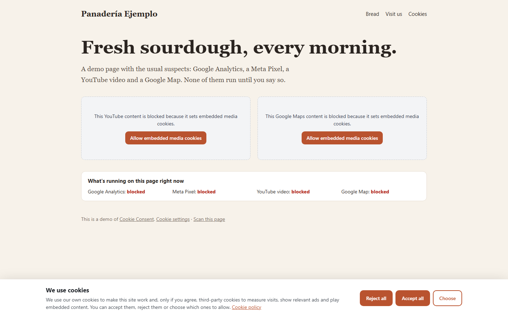
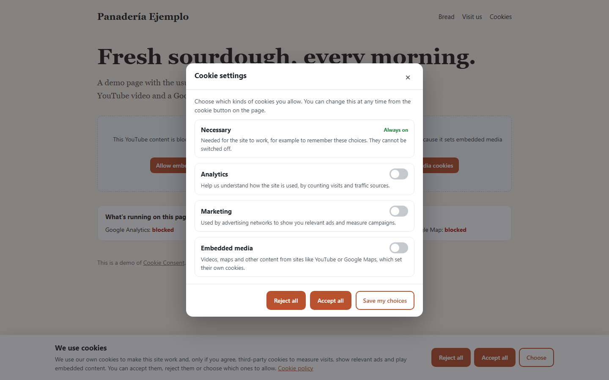
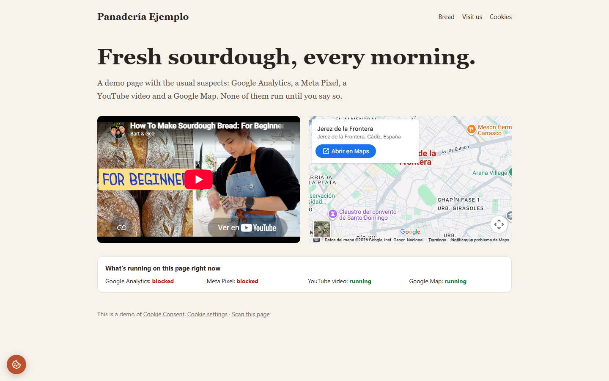
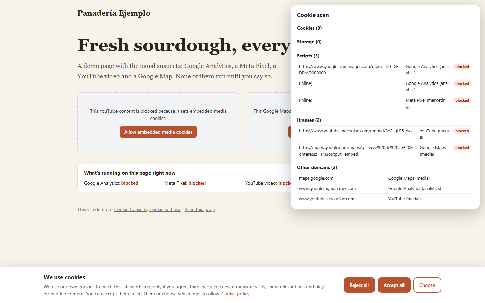
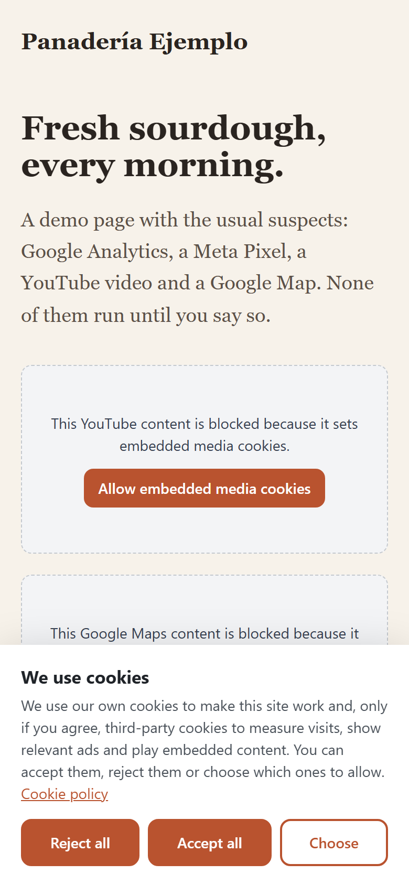

# Cookie Consent

Most of the websites I build are for small businesses in Spain, and almost all of them have the same problem: a cookie banner that looks the part but doesn't actually stop anything. Google Analytics and the Meta Pixel have already run by the time the visitor clicks "Reject", which is exactly what the rules are trying to prevent. The plugins that do it properly tend to be heavy, paid, or both.

So I wrote my own: a small script that loads first on the page, holds back known trackers and embeds until the visitor agrees, and then lets through only what they accepted. It works on any website, and it comes packaged as a WordPress plugin with a settings page.



## What it does

- **Really blocks trackers before consent.** Google Analytics and Tag Manager, the Meta Pixel, Hotjar, Microsoft Clarity, TikTok, LinkedIn, Google Ads, Pinterest and others are held back until the visitor allows them. It catches the script tags in the page, the copy-paste snippets that load them, and the scripts those snippets create.
- **Holds back embeds too.** YouTube, Vimeo, Google Maps, Spotify, Instagram and other iframes are replaced by a placeholder with a one-click "Allow" button.
- **Rejecting is as easy as accepting.** "Reject all" and "Accept all" sit side by side and look exactly the same, which is what the Spanish data protection agency (AEPD) asks for. Nothing is ticked in advance.
- **Categories:** necessary (always on), analytics, marketing and embedded media. Visitors can choose, and change their mind later from a small cookie button or any "Cookie settings" link.
- **Withdrawing consent cleans up.** If someone switches a category off, the cookies those services left behind (`_ga`, `_fbp` and so on) are deleted and the page reloads, so nothing keeps running.
- **Your own rules.** Anything the script doesn't know can be added as a rule, and you can mark your own scripts as "necessary" so they're never blocked.
- **Scan mode.** Add `?cookie-scan` to any address and a panel lists the cookies, stored data, outside scripts, iframes and other domains the page uses, with anything unrecognised flagged.
- **Google Consent Mode v2**, optional.
- **English and Spanish**, picked from the page language. Every text can be changed.
- **Small:** about 10 kB gzipped, no dependencies, and the banner lives in a shadow root so your theme's CSS can't break it.

| Choosing categories | Media allowed, trackers still blocked |
|---|---|
|  |  |

| Scan mode | On a phone |
|---|---|
|  |  |

## Using it on WordPress

1. Download `cookie-consent.zip` from the [Releases page](https://github.com/JuanCarlosCJ/cookie-consent/releases), then go to **Plugins → Add New → Upload Plugin**. (Or copy the `wordpress/cookie-consent` folder into `wp-content/plugins`.)
2. Activate it. The banner appears straight away with sensible defaults.
3. Go to **Settings → Cookie consent** to choose the categories your site uses, the position (bar, corner box or centred window), the button colour, your cookie policy page, and your own texts and rules.
4. Open **scan mode** from the same page to check what your site loads, and add a rule for anything marked "unknown".

The plugin prints the script as the very first thing in `<head>`, before any other plugin or theme adds theirs. It also goes one step further than the script alone can: it rewrites trackers and embeds **in the page itself, on the server**, so the browser doesn't even contact Google, Meta or YouTube until the visitor agrees (more on that [below](#how-it-works)). The page is the same for everyone, so it works with page caching.

You can put a "Cookie settings" link anywhere with the `[cookie_settings]` shortcode. It needs WordPress 6.5 and PHP 7.4 or newer, and its settings page is in English and Spanish.

## Using it on any other website

Copy `dist/cookie-consent.min.js` to your site and put these two tags at the very top of `<head>`, before any other script:

```html
<script data-cc-ignore>
  window.cookieConsentConfig = {
    policyUrl: '/cookie-policy',
    accent: '#b9532f',
  }
</script>
<script data-cc-ignore src="/js/cookie-consent.min.js"></script>
```

That's it. Leave your Google Analytics, Pixel and embed codes exactly as they are; the script takes care of them. `data-cc-ignore` tells it not to block itself (you can use it on any script you want left alone).

### Options

Everything is optional.

| Option | Default | What it does |
|---|---|---|
| `categories` | `['analytics', 'marketing', 'media']` | Which optional categories your site uses. Unused ones are hidden. |
| `position` | `'bar'` | `'bar'` at the bottom, `'box'` in the corner, or `'center'` as a window. |
| `policyUrl` | none | Link to your cookie policy, shown in the banner. |
| `accent` | `'#2563eb'` | Button colour. |
| `lang` | from `<html lang>` | `'en'` or `'es'`. |
| `texts` | built in | Your own texts, for example `{ es: { title: 'Cookies', message: '...' } }`. |
| `rules` | none | Your own rules (see below). |
| `floatingButton` | `true` | The small cookie button for changing the choice later. |
| `googleConsentMode` | `false` | Sends Google Consent Mode v2 signals. |
| `revision` | `1` | Increase it to ask everyone again, for example after adding a new tracker. |
| `expiresDays` | `365` | How long a choice is remembered (at most 730, as the AEPD suggests 24 months or less). |
| `cookieName` | `'cc_consent'` | The name of the cookie that stores the choice. |

### Rules

A rule says "anything whose address or code contains this belongs to that category":

```js
rules: [
  { name: 'Plausible', category: 'analytics', pattern: 'plausible.io' },
  { name: 'Ad server', category: 'marketing', pattern: /ads\.example\.(com|net)/ },
  { name: 'My CDN', category: 'necessary', pattern: 'cdn.mysite.com' }, // never blocked
]
```

Your rules are checked before the built-in ones. In WordPress you write them in the settings page, one per line: `analytics: plausible.io : Plausible`.

You can also mark things up by hand. These run (or load) only when their category is allowed:

```html
<script type="text/plain" data-cc-category="analytics">/* your code */</script>
<iframe data-cc-src="https://example.com/widget" data-cc-category="media"></iframe>
```

### JavaScript API

```js
CookieConsent.open()             // opens the settings panel
CookieConsent.acceptAll()
CookieConsent.rejectAll()
CookieConsent.set(['analytics']) // allows exactly these categories
CookieConsent.get()              // the stored choice, or null
CookieConsent.has('marketing')   // true or false
CookieConsent.scan()             // what scan mode shows, as data

window.addEventListener('cookieconsent:change', e => console.log(e.detail))
```

Any element with a `data-cc-open` attribute opens the settings when clicked.

## How it works

The difficult part of a cookie banner is the blocking, not the banner. A script only gets one chance to stop another script from running, so it has to be the first one on the page. From there it uses three ways in, so nothing slips through:

1. **What's already on the page** when it starts gets checked straight away.
2. **A `MutationObserver`** watches everything the browser adds while it reads the rest of the page. For scripts in the HTML, the observer runs before the script does, so there's still time to change its `type` to one the browser won't run (`javascript/blocked`). This is the same idea as the [yett](https://github.com/elbywan/yett) library.
3. **A patched `document.createElement`.** Tracking snippets usually create their real script from JavaScript, and an inline script created that way runs the moment it's added to the page, too fast for the observer. So scripts created this way are watched: as soon as their address or code is set, they're checked and blocked before they ever reach the page.

Iframes are simpler: the address is moved to `data-cc-src`, and a placeholder takes their place.

When the visitor allows a category, blocked scripts are re-created (a script whose type was changed never runs, even if you change it back) and iframes get their address back. Withdrawing consent is the opposite problem, since a script that has run can't be "un-run". The script deletes the cookies those services are known to set, on every level of the domain, and reloads the page.

**Stopping them from running isn't quite enough.** While testing with scan mode I noticed that the browser had still *contacted* Google and YouTube, even though nothing ran. Browsers look ahead in the HTML and start downloading scripts early, and an iframe starts loading the moment it's added, both before any JavaScript can step in. Those early requests can carry cookies.

That's why the WordPress plugin also rewrites the page on the server, using the same list of services (the build exports it to `rules.json` for PHP). Tracker scripts are sent as `type="text/plain"`, which browsers neither download nor run, and embeds are sent without their `src`. The script releases them later, or straight away for a returning visitor who already agreed. With that, a first visit makes no requests to any of those services until the visitor says yes. On other sites you get the same result by marking things up by hand (see [Rules](#rules)).

## What it can't do

I'd rather be clear about the limits:

- **Cookies set by your own server can't be blocked from the browser.** For example, a shop's cart or a login. They're usually "necessary" anyway, but they belong in your cookie policy.
- **Unknown trackers need a rule.** The script recognises around thirty common services. Scan mode helps you find the rest.
- **Scripts that run before it can't be stopped.** It has to be first in `<head>`. In WordPress the plugin does that for you, and its server-side rewriting also catches scripts a theme prints above `wp_head()`.
- **Without WordPress, the browser may still download (but not run) trackers written in the HTML**, for the reason explained above. Mark them up by hand to avoid even that.
- **It's a tool, not legal advice.** It helps you follow the AEPD's guidance (equal buttons, nothing pre-ticked, consent before cookies, easy withdrawal), but you still need a cookie policy that describes what your site really uses.

## Developing

You'll need [Node.js](https://nodejs.org) 20 or newer.

```bash
git clone https://github.com/JuanCarlosCJ/cookie-consent.git
cd cookie-consent
npm install
npm test
npm run demo
```

| Command | What it does |
|---|---|
| `npm test` | Runs the tests (Vitest with jsdom) |
| `npm run build` | Type-checks, builds `dist/cookie-consent.min.js` and copies it into the plugin |
| `npm run demo` | Builds and opens the demo page |

```
src/
  index.ts        starts everything, the window.CookieConsent API
  blocker.ts      holds back and releases scripts and iframes
  rules.ts        the known services and cookie names
  config.ts       checks the options
  consent.ts      the consent cookie and cleaning up cookies
  ui.ts           banner, settings, cookie button, placeholders
  styles.ts       their styles
  texts.ts        English and Spanish
  scan.ts         scan mode
test/             tests
demo/             the demo page
wordpress/cookie-consent/
  cookie-consent.php           the plugin
  includes/                    settings, front end, server-side rewriting, admin page
  languages/                   Spanish translation
  assets/                      the built script, rules.json, admin styles
docs/             screenshots
```

## License

[MIT](LICENSE) © Juan Carlos. Free to use on your own sites and your clients' sites.
